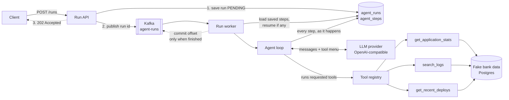

# Agent Harness

A durable runtime for AI agents, built around a **production-support agent** that investigates
incidents the way an on-call engineer does: it checks the customer impact, searches the logs,
looks at recent deployments, and reports a root cause with evidence.

The model only decides **what to check**. The harness (Java code) runs every check, records
every step, and enforces the limits. That runtime is the focus of the project: making AI agents
reliable, observable and safe enough for backend systems.

> **Status:** in active development. The agent, its tools, step persistence, asynchronous
> execution through Kafka and crash recovery are done. Retries and budgets are next.
> See the [roadmap](#roadmap).

---

## Example

```http
POST /runs
{ "incident": "Many customers got stuck during OTP on 15 October 2026 in the afternoon. Investigate." }
```

The agent investigates on its own:

```
Step 1  get_application_stats  15 Oct 12:00–17:00     → 45 applications STUCK (OTP_PENDING) at 16:00
Step 2  search_logs            otp-service, ERROR      → "OTP delivery delayed by Ns" ×22, 16:02–16:44
Step 3  search_logs            otp-service, all levels → 15:58 WARN "Kafka broker unreachable",
                                                          15:59 "1 of 4 consumers active", lag growing
Step 4  get_recent_deploys     otp-service             → no deployments
```

> **Root cause:** A Kafka broker outage caused the otp-service consumer to fall behind on the
> otp-events topic, delaying OTP delivery. 45 applications were stuck between 16:00 and 16:46 UTC.
> No deployment was involved.

`POST /runs` replies immediately with `202 Accepted` and a run id. A background worker does
the investigation, and `GET /runs/{id}` shows its status and the full trace of every step.

---

## How it works



### The agent loop

```
conversation = [instructions, incident report]
repeat (at most 10 model calls):
    reply = model(conversation, tool menu)
    save reply
    if reply has no tool requests → it's the final answer, stop
    for each requested tool:
        result = run the tool (in Java, with validated, parameterised queries)
        save result; add it to the conversation
```

- **The model never touches the database.** It returns a structured tool request, and the
  harness decides what actually runs. Tool inputs are treated as untrusted and bound as SQL
  parameters.
- **Every message is saved the moment it happens**, each in its own transaction. The saved
  steps *are* the conversation, which is what makes replay, audit and (next) crash recovery
  possible.
- **Tool errors don't crash the run.** They go back to the model as text, so it can correct
  itself.
- **Hard limits:** at most 10 model calls per run (counting calls made before a crash), a
  60s timeout per model call, and capped tool output.

### Asynchronous runs and crash recovery

`POST /runs` saves the run as `PENDING`, publishes its id to the `agent-runs` Kafka topic
(waiting for the broker's acknowledgement) and returns `202 Accepted` in milliseconds. A
`@KafkaListener` worker picks the run up and runs the agent loop.

The worker commits the Kafka offset **manually, only after a run is fully processed**. If the
worker dies mid-investigation, the offset is never committed and Kafka redelivers the message
(at-least-once delivery). Processing is therefore designed to be safe to repeat:

- a run that is already `COMPLETED` or `FAILED` is skipped (duplicate delivery)
- a run with saved steps **resumes**: the conversation is rebuilt from `agent_steps`, any tool
  requests that have no saved result are run, and the loop continues from there. Token totals
  stay correct because tokens are stored per step.
- a run with no saved steps starts fresh

**Kafka tracks *which* runs are unfinished; Postgres tracks *how far* each one got.**

Verified by killing the app (hard kill, no graceful shutdown) right after step 2 of an
investigation. On restart, Kafka redelivered the run, the worker logged
`Resumed from 6 saved messages (2 model calls, 2 tool calls already done)`, and it continued
at step 3 and completed, with no lost or repeated work.

### The fake bank

Real production data can't be used, so the project includes a deterministic **fake bank**
(Flyway migrations V2–V3): one busy day of an account-opening journey across five
microservices, with ~11,700 log lines, ~1,400 customer applications and the deployment history.

Five incidents of different kinds are planted in it, plus a red-herring deployment:

| Type | Clues the agent must connect |
|---|---|
| Bad deployment | New exceptions start right after a deploy, stop after the rollback |
| Database connection pool exhaustion | A batch job starts, then connection timeouts |
| External API outage | Upstream timeouts, with no change on our side |
| Kafka broker outage | Broker warning → consumer lag → delayed OTPs |
| Configuration typo | A config change, then valid customers rejected |

The data is generated without randomness, so the agent can be evaluated against a known
answer key, with the same exam every time.

---

## Tech stack

| Area | Technology |
|---|---|
| Language / framework | Java 17, Spring Boot 4 |
| Persistence | PostgreSQL 17, Spring Data JPA, Flyway migrations |
| Messaging | Apache Kafka (KRaft mode), Spring Kafka, manual offset commits |
| LLM | Any OpenAI-compatible chat-completions API (Groq in development), with tool calling |
| HTTP client | Spring `RestClient` with timeouts |
| Infrastructure | Docker Compose |
| Coming next | Testcontainers, Micrometer + Prometheus + Grafana, k6 |

The LLM provider sits behind an `LlmClient` interface. Switching providers is a configuration
change (base URL, model, key), and a different API format is one new class.

---

## Running locally

**Prerequisites:** Java 17, Docker, and an API key for an OpenAI-compatible provider
(for example a free [Groq](https://console.groq.com) key).

```bash
# 1. Start Postgres and Kafka
docker compose up -d

# 2. Provide the API key as an environment variable (never commit it)
#    Windows: set a user environment variable LLM_API_KEY
#    macOS/Linux:
export LLM_API_KEY=your-key

# 3. Run the app (Flyway creates and seeds the database on first start)
./mvnw spring-boot:run
```

Optional settings (environment variables): `LLM_BASE_URL`, `LLM_MODEL`, `DB_URL`, `DB_USER`,
`DB_PASSWORD`, `KAFKA_BOOTSTRAP_SERVERS`, and `AGENT_STEP_DELAY` (for example `8s`, which slows
runs down so you can kill the app mid-run and watch it resume).

### API

| Method | Path | Description |
|---|---|---|
| `POST` | `/runs` | Queue an investigation. Body: `{"incident": "..."}`. Returns `202 Accepted` with the run id |
| `GET` | `/runs/{id}` | A run's status (`PENDING`, `RUNNING`, `COMPLETED`, `FAILED`), final answer, token usage and every step |
| `GET` | `/actuator/health` | Health check |

```bash
curl -X POST http://localhost:8080/runs \
  -H 'Content-Type: application/json' \
  -d '{"incident": "Customers could not open accounts on 15 October 2026 in the morning. Investigate."}'
```

---

## Project structure

```
src/main/java/com/divya/agentharness/
├── agent/   AgentLoop: the ask → run tools → repeat loop, and the investigation instructions
├── llm/     LlmClient interface, OpenAI-compatible client, message and tool-call types
├── tools/   The three investigation tools, the tool registry and the service catalog
└── run/     Run and step persistence (JPA), RunService (queue, process, resume),
             RunWorker (Kafka consumer), the agent-runs topic and the /runs REST API

src/main/resources/db/migration/
├── V1  agent_runs table
├── V2  fake bank tables (services, deployments, app_logs, account_applications)
├── V3  one day of fake bank data with five planted incidents
├── V4  agent_steps table and run token totals
└── V5  tokens per step (correct totals across a resume)
```

---

## What I learned improving the agent

Each failure was found by reading the saved step trace, then fixed with a **general
investigation principle**. No incident-specific hints were added.

| Observed failure | Fix |
|---|---|
| The agent invented a service name that doesn't exist | The real service catalog is loaded into the instructions |
| It wandered across dates and reported the day's biggest incident, not the reported one | Stay within the reported date and time of day; low temperature (0.1) for consistency |
| It found the symptom ("OTP delayed") and guessed the cause | Search all log levels shortly before the errors begin; separate symptom from cause |
| `429 Too Many Requests` from the provider's rate limit | Planned: retry with backoff |
| Grouping logs by raw message failed (every line had a unique ID) | `search_logs` normalises numbers into patterns. Trade-off: it also masks useful numbers like broker IDs |
| Searched for "timeout" when the log said "timed out", found nothing, and blamed the wrong incident | Open: a search-quality issue to be measured and fixed with the evaluation suite |

To guard against overfitting the instructions to the known incidents, the evaluation suite
(planned) will also score the agent on held-out incident types it was never tuned on.

---

## Roadmap

- [x] Spring Boot + Postgres + Flyway foundation
- [x] Fake bank with five planted incidents and a red herring
- [x] Provider-agnostic LLM client with tool calling
- [x] Three investigation tools and the agent loop
- [x] Every run and step saved; `POST /runs` and `GET /runs/{id}`
- [x] **Asynchronous runs via Kafka**: `POST /runs` returns immediately, and workers process runs
- [x] **Crash recovery**: a run interrupted mid-investigation resumes from its last saved step
- [ ] Retries with backoff, idempotent tool calls, token and time budgets, loop detection
- [ ] Human approval gate for risky actions; live progress streaming (SSE)
- [ ] Integration tests with Testcontainers and a fake LLM
- [ ] Evaluation suite: accuracy on tuned and held-out incidents, steps and tokens per run
- [ ] Metrics dashboard, load test and chaos test (killing workers under load)
